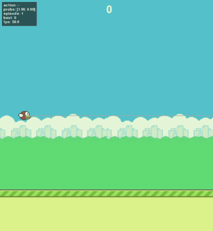

# 🐦 Flappy Bird AI Agent

A **Flappy Bird** clone (Python + pygame-ce) refactored into a standard **Gymnasium environment** for training AI agents: PPO, DQN (feature vector + pixels), NEAT and a heuristic baseline, with evaluation tooling, GIF/MP4 recording and a debug HUD.

- Headless game core, deterministic per seed, parity-tested against the original game.
- `FlappyBird-v0` env (Gymnasium) with an 8-dim feature observation or 84×84×4 stacked frames.
- Agents: `random`, `heuristic`, `dqn`, `ppo` (stable-baselines3), `neat` (neat-python).
- **PPO fully solves the game**: mean/median **220/220** over 100 episodes (hits the `max_episode_steps = 20,000` frame cap).

## 🎬 Demo

18 seconds of the pretrained PPO (~8 pipes) with the debug HUD: sensor line to the pipe gap, action, flap probability, episode, best score:



## 📊 Benchmark

Each agent runs 100 episodes on the fixed seed range `1000–1099` (disjoint from training seeds), `max_episode_steps = 20,000` frames ⇒ score cap of **220 pipes/episode**.

| Agent | Mean | Median | Max | Std | Notes |
|-------|------|--------|-----|-----|-------|
| Random | 0.00 | 0 | 0 | 0.00 | Dies on the ceiling immediately |
| Heuristic | 220.00 | 220 | 220 | 0.00 | **Hits the cap** every episode |
| DQN (features, 1M steps) | 0.05 | 0 | 5 | 0.50 | Fails to learn despite 4 ablations |
| PPO (features, 1M steps, `n_envs=8`) | 220.00 | 220 | 220 | 0.00 | **Solves the game** |
| NEAT (120 generations, 8 eps/genome) | 220.00 | 220 | 220 | 0.00 | Hits the cap from generation 25 |
| DQN (pixels, CnnPolicy, 2M steps) | 0.00 (100 eps) | 0 | 0 | 0.00 | Avoids ceiling/ground but dies at the first pipe |
| Headless throughput | **47,000 steps/s** (`scripts/benchmark_headless.py`) | | | | |

Heuristic, PPO and NEAT all reach the score cap, so "beating the heuristic" is impossible with the default config. Separating them would need a higher `max_episode_steps` or a smaller `pipe_gap`.

## 📥 Installation

Requires Python 3.12 (torch/pygame-ce have no stable wheels for 3.13+ yet). Uses [`uv`](https://docs.astral.sh/uv/):

```sh
git clone https://github.com/namvh236/flappy-bird.git
cd flappy-bird
uv sync                # creates .venv with the versions pinned in uv.lock
uv run pytest -q       # 37 tests
uv run ruff check .    # lint
```

Or with plain pip:

```sh
python3.12 -m venv .venv && .venv/bin/pip install -e ".[dev]"
```

## 📦 Pretrained model

`pretrained/ppo_best.zip` is the best model (PPO, 220/220 on seeds 1000–1099) and works directly with `--model`. `models/` and `runs/` are gitignored, so new training runs stay local.

## 🎮 Play yourself

```sh
.venv/bin/flappy-ai play --agent human          # new game core: click/Space to flap
.venv/bin/python -m flappy_ai.game.legacy       # original game, kept for parity tests
```

## 👀 Watch an agent

```sh
# Pretrained PPO
.venv/bin/flappy-ai play --agent ppo --model pretrained/ppo_best.zip --debug

# Heuristic (no model needed)
.venv/bin/flappy-ai play --agent heuristic --debug

# NEAT (after training one), showing the whole population at once
.venv/bin/flappy-ai play --population --birds 12 --genome models/neat_*/best_genome.pkl \
  --neat-config models/neat_*/config.cfg
```

Viewer keys: `+` / `-` change speed, `P` pause, `R` restart, `Esc` quit.
`--debug` enables `DebugOverlay`: sensor lines to the pipe gap, current action, Q-values (DQN) / flap probability (PPO) / output (NEAT), episode and best score.

## 🏋️ Training

```sh
# PPO — best config (n_envs=8), ~40 min for 800k steps on a laptop CPU/GPU
.venv/bin/flappy-ai train --algo ppo --config configs/ppo.yaml --seed 0

# DQN baseline (features) — does NOT converge despite 4 ablations (biased exploration, frame_skip, shaped reward, curriculum)
.venv/bin/flappy-ai train --algo dqn --config configs/dqn.yaml --seed 0

# DQN pixels (CnnPolicy, 84×84×4) — needs a GPU, slow
.venv/bin/flappy-ai train --algo dqn --config configs/dqn_pixels.yaml --seed 0 --device cuda

# NEAT (8 inputs → 1 output, fitness = frames_alive + 100 × pipes)
.venv/bin/flappy-ai train --algo neat --seed 0 --generations 120 --episodes-per-genome 8
```

On a headless machine set `SDL_VIDEODRIVER=dummy SDL_AUDIODRIVER=dummy`, otherwise `SubprocVecEnv` workers die silently.

Each run creates `runs/<algo>_<timestamp>_<pid>/` (used config, git commit hash, TensorBoard logs) and `models/<algo>_.../` (`best_model.zip` / `best_genome.pkl` + `config.cfg`). SB3 runs can continue with `--resume models/<run>/checkpoint.zip`.

## 📏 Evaluation

```sh
.venv/bin/flappy-ai eval --agent ppo --model pretrained/ppo_best.zip \
  --episodes 100 --seed 1000
```

Prints `mean / median / max / std` and the `death_cause` distribution, and writes `runs/eval/<agent>_results.json` + CSV. Add `--pixel-obs` for models trained on images, `--max-episode-steps N` to change the episode cap.

## 🎥 Record GIF/MP4

```sh
.venv/bin/flappy-ai record --agent ppo --model pretrained/ppo_best.zip \
  --out demo.gif --frames 900 --fps 50 --overlay --scale 0.5
```

`--overlay` enables the HUD, `--scale` shrinks frames (an 864×936 GIF is very large), a `.mp4` extension writes a video.

## 🗂 Repo layout

```
src/flappy_ai/
├── game/        # GameConfig, FlappyGame (headless), entities, legacy.py (original game)
├── render/      # PygameRenderer, DebugOverlay, PopulationRenderer
├── env/         # FlappyBirdEnv (Gymnasium), observation, reward, wrappers (FrameSkip, PixelObs)
├── agents/      # factory + random/heuristic/sb3/neat agents
├── training/    # train_sb3.py, train_neat.py, callbacks
├── evaluation/  # evaluate.py, play.py, record.py
└── cli.py       # flappy-ai play|train|eval|record
configs/         # dqn, ppo, dqn_pixels, neat.cfg + DQN ablations
scripts/         # benchmark_headless.py
tests/           # core, env, parity, agents, evaluate, training, neat, pixels, record, population
pretrained/      # ppo_best.zip
media/           # ppo_demo.gif
```

## ⚠️ Intentional differences from the original game

1. Pipes spawn per **frame count** (`pipe_interval_frames = 90`) instead of `pygame.time.get_ticks()` — deterministic, independent of machine speed.
2. `reset(seed)` re-initialises **all** state (the original forgot to reset `vel`, `pass_pipe`, ...).
3. Scoring uses a per-pipe `passed` flag (the original could double-count when several pipes overlap).
4. No "click to start" phase; each `step(flap=True)` is one click.
5. Episode cap of 20,000 frames ⇒ at most 220 pipes/episode.

## 🧪 Tests & quality

```sh
uv run pytest -q        # 37 tests: physics, collision, scoring, parity, env, agents, training/resume, neat, pixels, record, population
uv run ruff check .     # lint
uv run ruff format .    # format
```

`tests/test_parity.py` replays the same action sequence on `game/legacy.py` and `FlappyGame` and compares the `bird.y` trajectory over the first 300 frames, so the refactor keeps the original feel.

## 📌 Open items

- **Ranking agents properly**: heuristic, PPO and NEAT all hit the 220-pipe cap and tie — raise `max_episode_steps` or lower `pipe_gap` to separate them.
- **DQN** (features and pixels) does not reach the goal; ideas to try: double DQN, n-step returns, pre-scaled rendering.
